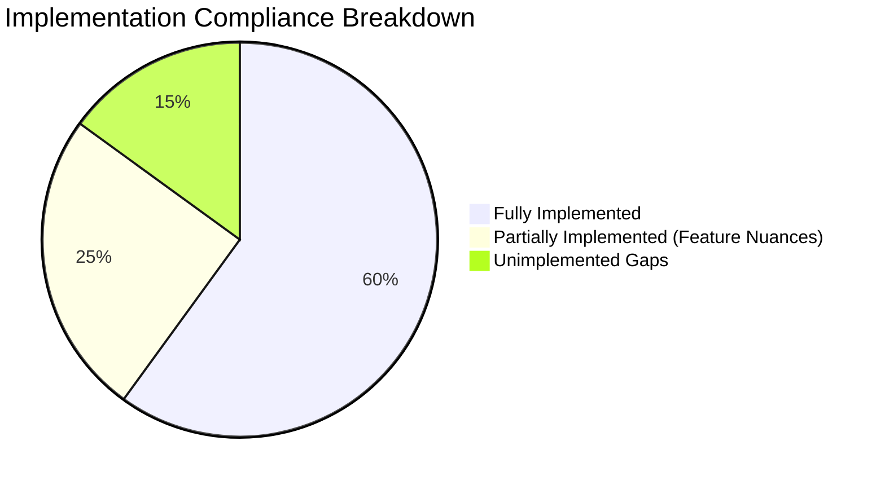

# CareSync HMS — Specification Compliance Audit & Gap Analysis

**Audit Date**: October 9, 2026  
**Audited Against**: [project_specification.md](file:///V:/hms_project/docs/project_specification.md)  
**Codebase Evaluated**: Frontend (`client/`), Backend API (`server/`), Database (`server/prisma/schema.prisma`)

---

## 1. Executive Summary & Compliance Scorecard

A thorough audit of the implemented CareSync HMS was conducted against the system requirements outlined in the official project specification. 

| Functional Area | Spec Section | Implementation Status | Compliance Score |
| :--- | :--- | :--- | :---: |
| **User Management & RBAC** | §3.1 | ✅ Implemented | **95%** |
| **Patient Management** | §3.2 | ⚠️ Partial (Missing document uploads & edit modal) | **80%** |
| **Doctor Management** | §3.3 | ⚠️ Partial (Backend API exists; Admin Doctor CRUD UI needed) | **75%** |
| **Appointment Management** | §3.4 | ⚠️ Partial (Booking & status work; Reschedule workflow missing) | **80%** |
| **Electronic Medical Records** | §3.5 | ✅ Implemented | **95%** |
| **Laboratory Management** | §3.6 | ⚠️ Partial (Requests & results work; Printable report slip missing) | **85%** |
| **Pharmacy Management** | §3.7 | ✅ Implemented (Batch tracking, FIFO, alerts, dispensing) | **95%** |
| **Billing System** | §3.8 | ⚠️ Partial (Invoicing & payments work; Print receipt view missing) | **85%** |
| **Staff & HR Management** | §3.9 | ❌ Gap (Database schema exists; APIs & Frontend UI missing) | **25%** |
| **Reports & Analytics** | §3.10 | ⚠️ Partial (Dashboard KPIs exist; Dedicated Reports module missing) | **40%** |
| **Non-Functional & Security** | §4 & §10 | ⚠️ Partial (Prisma schema ready; backup scripts & audit middleware needed) | **70%** |

**Overall Specification Compliance**: **~75% Core Implemented / 25% Gaps Identified**

---

## 2. Module-by-Module Detailed Audit & Gap Findings

### 2.1 User Management & Security (§3.1, §4)
- **Specified in Requirements**:
  - Login, Logout, Password Management, User Roles, Access Control, Password Encryption, Session Timeout, Audit Logs.
- **Current State**:
  - ✅ JWT login, bearer authentication, bcrypt password hashing, and role checks (`ADMIN`, `DOCTOR`, `NURSE`, `RECEPTIONIST`, `LAB_STAFF`, `PHARMACIST`, `ACCOUNTANT`) are fully functional.
  - ✅ Dynamic role-based frontend sidebar filtering and navigation guards are implemented.
- **Identified Gaps**:
  - 🔍 **Gap 1.1 — Automated Audit Trail Middleware**: The `AuditLog` table exists in [schema.prisma](file:///V:/hms_project/server/prisma/schema.prisma#L278-L290), but an Express middleware to automatically log create/update/delete operations and IP addresses is not yet attached to routes.
  - 🔍 **Gap 1.2 — User Password Change / Profile Settings**: No self-service "Change Password" endpoint or UI screen currently exists.

---

### 2.2 Patient Management (§3.2, §7.3)
- **Specified in Requirements**:
  - Register Patient, Update Patient Information, Search Patient, View Medical History, Upload Documents.
- **Current State**:
  - ✅ Patient registration modal with automatic unique patient code generation (`PAT-YYYYMM-XXXX`).
  - ✅ Search by name, phone number, and patient code with debounced listing.
  - ✅ 360° Comprehensive Patient Profile ([PatientDetailPage.tsx](file:///V:/hms_project/client/src/pages/patients/PatientDetailPage.tsx)) containing Demographics, Clinical Consultations, Appointments, Lab Orders, and Invoices.
  - ✅ Backend `PUT /api/patients/:id` update endpoint is implemented.
- **Identified Gaps**:
  - 🔍 **Gap 2.1 — Medical Document / File Uploads**: Spec §3.2 states *"Upload Documents"* (e.g. past discharge summaries, external X-rays/scans). Neither file storage (multer) nor upload UI is currently built.
  - 🔍 **Gap 2.2 — Frontend Edit Patient Dialog**: The backend supports updating patient records, but the frontend only has an "Add Patient" modal; an inline "Edit Demographics" button/dialog is missing on the Patient Detail screen.

---

### 2.3 Doctor & Appointment Management (§3.3, §3.4, §7.4)
- **Specified in Requirements**:
  - Doctor Management: Add Doctor, Update Doctor Details, Department Assignment, Schedule Management.
  - Appointment Management: Book Appointment, Cancel Appointment, Reschedule Appointment, Appointment Status Tracking, Calendar View.
- **Current State**:
  - ✅ Department and Doctor models with consultation fees and shift schedules.
  - ✅ Appointment booking with automated double-booking/collision prevention by time slot and date.
  - ✅ Status workflow tracking (`SCHEDULED`, `CONFIRMED`, `IN_CONSULTATION`, `COMPLETED`, `CANCELLED`).
  - ✅ Filtering by Doctor and Date in [AppointmentsPage.tsx](file:///V:/hms_project/client/src/pages/appointments/AppointmentsPage.tsx).
- **Identified Gaps**:
  - 🔍 **Gap 3.1 — Reschedule Appointment Action**: Spec §3.4 specifies *"Reschedule Appointment"*. Currently, appointments can be created, confirmed, completed, or cancelled, but there is no direct "Reschedule Slot" action to modify `appointmentDate` and `timeSlot`.
  - 🔍 **Gap 3.2 — Admin Doctor Directory & Shift Manager UI**: Doctors are listed in dropdowns, but Administrators lack a dedicated UI tab to add new doctors, change consultation fees, or define weekly availability schedules.
  - 🔍 **Gap 3.3 — Interactive Visual Calendar Grid**: Spec §7.4 requests *"Calendar View"*. While date filtering is present, a full month/week interactive visual grid (e.g., FullCalendar) is not yet integrated.

---

### 2.4 Laboratory Management (§3.6)
- **Specified in Requirements**:
  - Test Requests, Sample Collection, Result Entry, Report Generation.
- **Current State**:
  - ✅ Standard Lab Test catalog (CBC, Lipid Profile, Blood Sugar, Urinalysis).
  - ✅ Doctors can order tests with urgency classification (`ROUTINE`, `URGENT`).
  - ✅ Lab Technicians have a dedicated test queue to enter findings, reference ranges, and clinical interpretations.
- **Identified Gaps**:
  - 🔍 **Gap 4.1 — Sample Collection State Transition**: Spec §3.6 notes *"Sample Collection"*. Currently, the flow transitions directly from `REQUESTED` to `COMPLETED`; an intermediate step for `SAMPLE_COLLECTED` with collection timestamp is absent in the UI.
  - 🔍 **Gap 4.2 — Printable Lab Report / PDF**: Spec §3.6 notes *"Report Generation"*. There is no formatted printable lab report sheet / PDF export for the patient.

---

### 2.5 Pharmacy Management (§3.7)
- **Specified in Requirements**:
  - Medicine Inventory, Prescription Processing, Stock Management, Expiry Monitoring.
- **Current State**:
  - ✅ Medicine catalog with dosage units and pricing.
  - ✅ Inventory batches with batch numbers, expiry dates, and cost/selling prices.
  - ✅ Automatic FIFO (First-In, First-Out) stock decrementing in a database transaction when dispensing prescriptions.
  - ✅ Expiry and low-stock alert banners on the dashboard and pharmacy page.
- **Identified Gaps**:
  - No major architectural gaps found. Fully compliant with §3.7.

---

### 2.6 Billing & Payment System (§3.8, §7.5)
- **Specified in Requirements**:
  - Consultation Charges, Laboratory Charges, Pharmacy Charges, Admission Charges, Invoice Generation, Payment Recording, Print Receipt.
- **Current State**:
  - ✅ Multi-item invoice builder supporting all charge categories (`CONSULTATION`, `LAB_TEST`, `PHARMACY`, `ROOM_CHARGE`, `PROCEDURE`, `OTHER`).
  - ✅ Calculation of line items, discounts, taxes, and net totals.
  - ✅ Multi-method payment processing (`CASH`, `CARD`, `ONLINE`, `INSURANCE`).
  - ✅ Automatic status progression (`UNPAID` → `PARTIAL` → `PAID`).
- **Identified Gaps**:
  - 🔍 **Gap 6.1 — Print Receipt / Invoice View**: Spec §3.8 & §7.5 require *"Print Receipt"*. A printable layout (with hospital header, tax breakdown, and payment voucher format) is missing.

---

### 2.7 Staff Management (§3.9) — **PRIMARY GAP**
- **Specified in Requirements**:
  - Employee Registration, Attendance Tracking, Department Assignment, Leave Records.
- **Current State**:
  - ⚠️ The database models (`Employee`, `Attendance`, `LeaveRequest`) are fully defined in [schema.prisma](file:///V:/hms_project/server/prisma/schema.prisma#L86-L113).
- **Identified Gaps**:
  - 🔍 **Gap 7.1 — No Backend Staff API Routes**: No controller or routes for `/api/staff/employees`, `/api/staff/attendance`, or `/api/staff/leaves`.
  - 🔍 **Gap 7.2 — No Frontend Staff UI**: No navigation item or page for HR/Administrators to register staff members, clock daily attendance, or review leave requests.

---

### 2.8 Reports & Analytics (§3.10) — **PRIMARY GAP**
- **Specified in Requirements**:
  - Patient Reports, Appointment Reports, Revenue Reports, Pharmacy Reports, Laboratory Reports, Staff Reports.
- **Current State**:
  - ⚠️ The Dashboard provides high-level live KPI summaries (Total Patients, Today's Appointments, Revenue, Active Admissions, Pending Labs, Low Stock).
- **Identified Gaps**:
  - 🔍 **Gap 8.1 — Dedicated Reports Engine & Export**: No standalone Reports page exists allowing date-range filtering, tabular drilldowns, revenue trends over time (Recharts line/bar charts), or CSV/PDF exports.

---

### 2.9 Non-Functional Requirements & Backups (§4, §10)
- **Specified in Requirements**:
  - Automatic Daily Backup, Audit Trail, High Availability, Disaster Recovery.
- **Current State**:
  - ✅ Native PostgreSQL cluster initialized and running with ACID relational transactions.
- **Identified Gaps**:
  - 🔍 **Gap 9.1 — Automated Backup Script**: No scheduled automated backup script utilizing `pg_dump` to dump `hms_db` to a backup directory.

---

## 3. Prioritized Gap Summary Table

| Gap ID | Severity | Missing Capability | Impacted Files |
| :--- | :---: | :--- | :--- |
| **GAP-1** | 🔴 High | **Staff Management Module** (Employee list, attendance logging, leave approvals) | Backend: `staff.controller.ts`, `staff.routes.ts` Frontend: `StaffPage.tsx` |
| **GAP-2** | 🔴 High | **Comprehensive Reports Module** (Revenue, appointments, patients, pharmacy analytics) | Backend: `report.controller.ts`, `report.routes.ts` Frontend: `ReportsPage.tsx` |
| **GAP-3** | 🟡 Medium | **Printable Receipt & Lab Slip** (Print-friendly format for invoices and lab test results) | Frontend: `InvoiceReceiptModal.tsx`, `LabReportModal.tsx` |
| **GAP-4** | 🟡 Medium | **Appointment Rescheduling** (Reschedule date/slot from appointment queue) | Backend: `appointment.controller.ts` Frontend: `AppointmentsPage.tsx` |
| **GAP-5** | 🟡 Medium | **Patient Document Attachments** (Upload & download past records/scans) | Backend: Multer upload route Frontend: `PatientDetailPage.tsx` |
| **GAP-6** | 🟡 Medium | **Patient Demographics Edit Form** (Update patient address, phone, emergency contact) | Frontend: `EditPatientModal.tsx` in `PatientsPage.tsx` |
| **GAP-7** | 🟢 Low | **Lab Sample Collection Step** (Track transition from requested to collected) | Frontend: `LabPage.tsx` |
| **GAP-8** | 🟢 Low | **Audit Logging Interceptor** (Record modifications automatically to `audit_logs`) | Backend: `audit.middleware.ts` |
| **GAP-9** | 🟢 Low | **Automated PostgreSQL Backup Utility** (`pg_dump` script) | Backend: `scripts/backup-db.ts` |

---

## 4. Recommended Action Plan

To bring the project to **100% complete specification alignment**, execution should proceed in two focused sprints:

### Sprint 1: Critical Missing Functional Modules (GAPs 1, 2, 3)
1. **Implement Staff Management**:
   - Create `server/src/controllers/staff.controller.ts` & `staff.routes.ts` (CRUD for employees, attendance check-in/out, leave requests).
   - Create `client/src/pages/staff/StaffPage.tsx` with tabs for Staff Directory, Attendance, and Leave Approvals.
2. **Implement Dedicated Reports & Analytics**:
   - Create `server/src/controllers/report.controller.ts` (Revenue aggregations, patient visit trends, pharmacy usage, lab throughput).
   - Create `client/src/pages/reports/ReportsPage.tsx` with Recharts visual trend graphs and data tables.
3. **Add Printable Documents**:
   - Add printable invoice voucher / thermal POS layout to Billing.
   - Add printable official diagnostic test report to Laboratory.

### Sprint 2: Workflow Enhancements & Non-Functional Hardening (GAPs 4–9)
1. Add appointment reschedule modal and status tracking.
2. Add document uploads (PDF/Images) with local file storage for patient profiles.
3. Add inline Edit Patient demographics dialog.
4. Add automated audit log recording middleware and automated database backup script.
