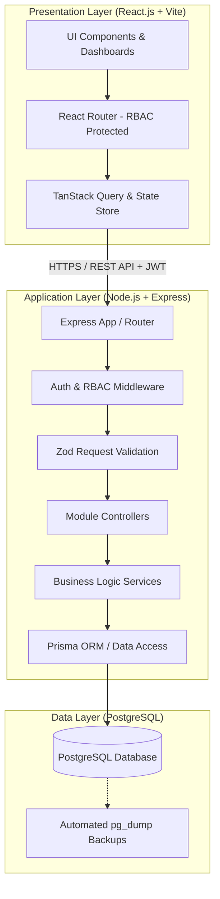
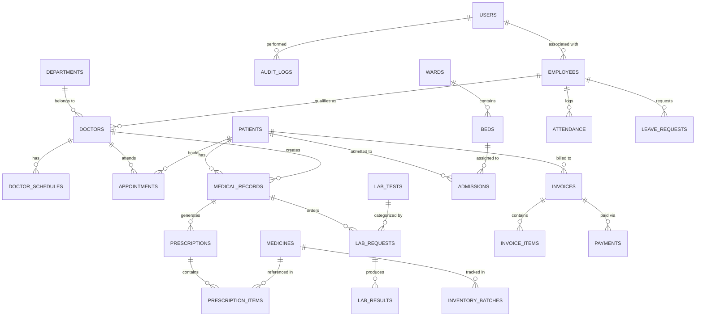
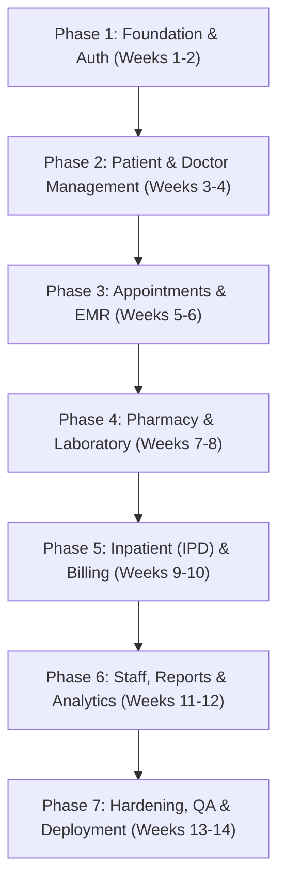

# Hospital Management System (HMS) — Implementation Plan & Technical Architecture

## 1. Executive Summary & Scope

This plan defines the end-to-end technical architecture, database schema, API design, frontend layouts, and phased development roadmap for the **Hospital Management System (HMS)** based on the specification in [project_specification.md](file:///V:/hms_project/docs/project_specification.md).

### Target Technology Stack
- **Backend**: Node.js (TypeScript, Express.js, Prisma ORM, Zod validation, JWT + bcrypt)
- **Frontend**: React.js (TypeScript, Vite, Tailwind CSS, Lucide Icons, TanStack Query, React Hook Form, Recharts, FullCalendar)
- **Database**: PostgreSQL (Relational schema, foreign keys, ACID-compliant transactions, indexing, audit logging)
- **Tooling & Infrastructure**: Docker / Local PostgreSQL, npm/pnpm workspaces, Winston logger.

---

## 2. System Architecture

The application adopts a clean, layered 3-tier architecture with clear separation of concerns:



---

## 3. Database Architecture (PostgreSQL)

### 3.1 Entity Relationship Diagram



### 3.2 Core Table Specifications

1. **`users` & `roles`**:
   - `id` (UUID, PK), `username`, `email`, `password_hash`, `role` (`ADMIN`, `DOCTOR`, `NURSE`, `RECEPTIONIST`, `LAB_STAFF`, `PHARMACIST`, `ACCOUNTANT`), `is_active`, `last_login`, `created_at`, `updated_at`.
2. **`patients`**:
   - `id` (UUID, PK), `patient_code` (Unique human-friendly ID, e.g., `PAT-2026-0001`), `first_name`, `last_name`, `dob`, `gender`, `blood_group`, `contact_number`, `email`, `address`, `emergency_contact_name`, `emergency_contact_phone`, `allergies`, `medical_history_summary`, `created_at`.
3. **`departments` & `doctors`**:
   - `departments`: `id`, `name`, `description`, `head_doctor_id`.
   - `doctors`: `id`, `user_id` (FK), `department_id` (FK), `specialization`, `license_number`, `consultation_fee`, `is_available`.
   - `doctor_schedules`: `id`, `doctor_id` (FK), `day_of_week` (0-6), `start_time`, `end_time`, `slot_duration_minutes`.
4. **`appointments`**:
   - `id` (UUID, PK), `patient_id` (FK), `doctor_id` (FK), `appointment_date`, `time_slot`, `status` (`SCHEDULED`, `CONFIRMED`, `IN_CONSULTATION`, `COMPLETED`, `CANCELLED`, `NO_SHOW`), `reason`, `notes`.
5. **`medical_records` (EMR)**:
   - `id` (UUID, PK), `patient_id` (FK), `doctor_id` (FK), `appointment_id` (FK, Nullable), `symptoms`, `diagnosis`, `vitals` (JSONB: blood_pressure, pulse, temperature, spo2, weight), `treatment_plan`, `visit_date`.
6. **`prescriptions` & `prescription_items`**:
   - `prescriptions`: `id`, `medical_record_id` (FK), `patient_id` (FK), `doctor_id` (FK), `status` (`PENDING`, `DISPENSED`, `CANCELLED`), `notes`.
   - `prescription_items`: `id`, `prescription_id` (FK), `medicine_id` (FK), `dosage`, `frequency` (e.g., 1-0-1), `duration_days`, `instructions`, `quantity_dispensed`.
7. **`medicines` & `inventory_batches`**:
   - `medicines`: `id`, `name`, `generic_name`, `category`, `unit` (tablets, bottles, injections), `unit_price`, `reorder_level`.
   - `inventory_batches`: `id`, `medicine_id` (FK), `batch_number`, `expiry_date`, `quantity_in_stock`, `purchase_price`, `selling_price`.
8. **`lab_tests`, `lab_requests` & `lab_results`**:
   - `lab_tests`: `id`, `test_name`, `category`, `cost`, `standard_range`, `sample_type`.
   - `lab_requests`: `id`, `patient_id` (FK), `doctor_id` (FK), `test_id` (FK), `status` (`REQUESTED`, `SAMPLE_COLLECTED`, `IN_PROGRESS`, `COMPLETED`, `CANCELLED`), `urgency` (`ROUTINE`, `URGENT`).
   - `lab_results`: `id`, `request_id` (FK), `result_value`, `normal_range`, `interpretation`, `performed_by` (FK to User), `verified_by` (FK to User), `result_date`.
9. **`inpatient_management` (Wards, Beds, Admissions)**:
   - `wards`: `id`, `name`, `type` (`GENERAL`, `ICU`, `MATERNITY`, `PEDIATRIC`), `daily_rate`.
   - `beds`: `id`, `ward_id` (FK), `bed_number`, `is_occupied`.
   - `admissions`: `id`, `patient_id` (FK), `doctor_id` (FK), `bed_id` (FK), `admission_date`, `discharge_date`, `admission_reason`, `discharge_summary`, `status` (`ADMITTED`, `DISCHARGED`).
10. **`billing`, `invoices`, `payments`**:
    - `invoices`: `id`, `invoice_number` (`INV-2026-XXXX`), `patient_id` (FK), `total_amount`, `discount_amount`, `tax_amount`, `net_amount`, `status` (`UNPAID`, `PARTIAL`, `PAID`, `CANCELLED`), `created_at`.
    - `invoice_items`: `id`, `invoice_id` (FK), `service_type` (`CONSULTATION`, `LAB_TEST`, `PHARMACY`, `ROOM_CHARGE`, `OTHER`), `item_description`, `quantity`, `unit_price`, `total_price`.
    - `payments`: `id`, `invoice_id` (FK), `amount_paid`, `payment_method` (`CASH`, `CARD`, `ONLINE`, `INSURANCE`), `transaction_ref`, `payment_date`, `received_by` (FK).
11. **`staff`, `attendance`, `leaves`**:
    - `employees`: `id`, `user_id` (FK), `employee_code`, `first_name`, `last_name`, `designation`, `department_id` (FK), `joining_date`, `phone`, `salary`.
    - `attendance`: `id`, `employee_id` (FK), `date`, `check_in`, `check_out`, `status` (`PRESENT`, `ABSENT`, `ON_LEAVE`, `HALF_DAY`).
    - `leave_requests`: `id`, `employee_id` (FK), `start_date`, `end_date`, `leave_type`, `status` (`PENDING`, `APPROVED`, `REJECTED`).
12. **`audit_logs`**:
    - `id`, `user_id` (FK), `action`, `entity_name`, `entity_id`, `details` (JSONB), `ip_address`, `timestamp`.

---

## 4. Backend Architecture (Node.js + Express)

### 4.1 Folder Structure
```
server/
├── prisma/
│   ├── schema.prisma             # Data models & relations
│   ├── seed.ts                   # Seed script (Admin, initial roles, departments)
│   └── migrations/               # PostgreSQL schema migrations
├── src/
│   ├── config/                   # Environment variables, DB client
│   ├── constants/                # Enums, error codes, role definitions
│   ├── controllers/              # Request handlers
│   │   ├── auth.controller.ts
│   │   ├── patient.controller.ts
│   │   ├── doctor.controller.ts
│   │   ├── appointment.controller.ts
│   │   ├── emr.controller.ts
│   │   ├── lab.controller.ts
│   │   ├── pharmacy.controller.ts
│   │   ├── billing.controller.ts
│   │   ├── inpatient.controller.ts
│   │   └── report.controller.ts
│   ├── middlewares/              # Auth, RBAC, error handling, rate limiting
│   │   ├── auth.middleware.ts
│   │   ├── rbac.middleware.ts
│   │   ├── validate.middleware.ts
│   │   └── error.middleware.ts
│   ├── routes/                   # Route declarations
│   ├── services/                 # Pure business logic and DB transactions
│   ├── utils/                    # PDF generator, audit logger, hashers
│   └── app.ts                    # Express bootstrap & middleware registration
└── package.json
```

### 4.2 Security & Transaction Strategy
- **Authentication**: JWT access tokens (short-lived, 15m) + secure HTTP-only refresh tokens (7d).
- **Access Control**: Declarative RBAC middleware:
  `router.post('/prescriptions', authenticate, authorize(['DOCTOR']), createPrescription)`
- **Database Transactions**: PostgreSQL ACID transactions (via `prisma.$transaction`) ensure financial consistency when generating invoices, issuing payments, and decrementing pharmacy inventory.
- **Audit Trails**: Every sensitive action (prescriptions, test results, billing modifications, admission records) creates an immutable `audit_logs` row.

---

## 5. Frontend Architecture (React.js + Vite)

### 5.1 Folder Structure
```
client/
├── public/                       # Logos, hospital assets
├── src/
│   ├── assets/                   # Styles, global icons
│   ├── components/
│   │   ├── common/               # Modal, Table, Button, StatusBadge, DatePicker
│   │   ├── layout/               # Sidebar, Header, NotificationCenter, ProtectedLayout
│   │   ├── patients/             # PatientCard, MedicalTimeline, VitalsChart
│   │   ├── appointments/         # CalendarView, SlotPicker, AppointmentModal
│   │   ├── pharmacy/             # InventoryTable, DispenseModal, ExpiryAlertBadge
│   │   └── billing/              # InvoiceBuilder, PaymentReceiptModal, InvoicePDF
│   ├── context/                  # AuthContext, ThemeContext
│   ├── hooks/                    # useAuth, useDebounce, usePagination
│   ├── pages/
│   │   ├── auth/Login.tsx
│   │   ├── dashboard/            # Dynamic dashboard per role (Admin/Doctor/Lab/etc.)
│   │   ├── patients/             # Patient list, registration, patient detail 360 view
│   │   ├── appointments/         # Scheduling grid and calendar
│   │   ├── emr/                  # Doctor consultation & prescription workspace
│   │   ├── laboratory/           # Lab queue, sample collection, report upload/input
│   │   ├── pharmacy/             # Stock management, drug catalog, prescription queue
│   │   ├── inpatient/            # Ward & bed visual allocation map
│   │   ├── billing/              # Invoice generator, ledger, POS receipt modal
│   │   ├── staff/                # Staff directory, attendance tracker, payroll
│   │   └── reports/              # Revenue, patient count, pharmacy analytics
│   ├── services/api.ts           # Axios / Fetch client with auth interceptors
│   ├── types/                    # Shared TypeScript interfaces
│   └── App.tsx                   # Route definitions
└── package.json
```

### 5.2 Role-Tailored Portals

| Role | Primary Views & Permissions |
| :--- | :--- |
| **Admin** | Full system overview, Revenue KPIs, Staff management, Audit logs, Department config |
| **Doctor** | Today's appointment queue, Patient EMR history, Prescription pad, Order lab tests |
| **Receptionist** | Quick patient registration, Appointment booking & calendar, Check-in / Queue triage |
| **Nurse** | Vitals recording, Inpatient ward/bed monitor, Doctor round assistance |
| **Lab Tech** | Pending test requests, Sample collection confirmation, Test result submission |
| **Pharmacist** | Prescription dispensation, Stock decrement, Low-stock & Expiry alerts, Purchase entry |
| **Accountant** | Consolidated billing (Consultation + Lab + Pharmacy + IPD), Payments, Daily cash reconciliation |

---

## 6. Implementation Roadmap



### Phase 1: Foundation & Authentication (Weeks 1-2)
- [ ] Initialize project monorepo (`server/` and `client/`).
- [ ] Install Node.js, Express, TypeScript, Prisma, and PostgreSQL.
- [ ] Set up PostgreSQL database and run base schema migrations (`users`, `roles`, `audit_logs`).
- [ ] Build Authentication APIs (Login, Token Refresh, Password Reset, Logout).
- [ ] Implement React frontend foundation (Vite, Tailwind CSS, React Router, Auth Context).
- [ ] Build Login screen and role-based route guard.

### Phase 2: Patient & Doctor Management (Weeks 3-4)
- [ ] Implement `patients`, `departments`, `doctors`, and `doctor_schedules` models and migrations.
- [ ] Build CRUD REST endpoints with Zod validation.
- [ ] Create Patient Registration, Search, and Patient Detail 360 view in React.
- [ ] Create Doctor directory, Department assignment, and Doctor shift scheduling UI.

### Phase 3: Appointment Scheduling & EMR (Weeks 5-6)
- [ ] Build Appointment booking engine with slot collision prevention.
- [ ] Implement Appointment Calendar view (FullCalendar/react-big-calendar).
- [ ] Develop Electronic Medical Records (EMR) module:
  - Doctor consultation interface (vitals, symptoms, diagnosis, treatment notes).
  - Digital Prescription builder with dosages and frequencies.
- [ ] Historical medical timeline view for patient records.

### Phase 4: Laboratory & Pharmacy Management (Weeks 7-8)
- [ ] Database models for `medicines`, `inventory_batches`, `lab_tests`, `lab_requests`, `lab_results`.
- [ ] **Pharmacy module**:
  - Medicine inventory catalog, batch tracking, reorder thresholds, expiry monitor.
  - Prescription fulfillment workflow with automatic stock decrement.
- [ ] **Laboratory module**:
  - Test order workflow, sample collection status tracking.
  - Result entry with reference ranges and printable PDF lab reports.

### Phase 5: Inpatient (IPD) & Comprehensive Billing (Weeks 9-10)
- [ ] **Inpatient Module**:
  - Ward and bed management (visual interactive bed occupancy board).
  - Patient admission, daily bed charge calculation, and discharge summaries.
- [ ] **Billing & Invoicing**:
  - Unified invoice generation aggregating consultation fees, lab orders, pharmacy items, and room charges.
  - Multi-method payment processing (Cash, Card, Online, Insurance).
  - Printable tax invoices and receipts.

### Phase 6: Staff Management, Reporting & Analytics (Weeks 11-12)
- [ ] Staff directory, employee records, shift scheduling, and attendance logging.
- [ ] Executive Dashboards with Recharts:
  - Daily/Monthly Revenue analytics.
  - Patient volume & department occupancy metrics.
  - Pharmacy stock turnover and low stock alerts.
  - Lab test volume reports.
- [ ] Comprehensive Audit Trail viewer for Admins.

### Phase 7: Quality Assurance, Security Hardening & Deployment (Weeks 13-14)
- [ ] Automated daily backup script for PostgreSQL using `pg_dump`.
- [ ] Session timeout and rate limiting (prevent brute force on login).
- [ ] End-to-end user acceptance testing across all 7 hospital roles.
- [ ] Production build optimization (Vite bundle splitting, DB query index tuning).
- [ ] Deployment guide (Docker / Nginx reverse proxy / Systemd / Windows Service).
